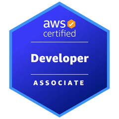

  
  
  
  
  

# 𝖍𝖎, 𝖎’𝖒 𝖓𝖆𝖛𝖎.

  

software engineer. researcher. student of systems.

**navi revenge** is my creative alter ego. the software engineer behind it is [NazWright](https://github.com/NazWright).

**navi** is an alias. it stands for *naz always ventures inward*.

i’ve always been fascinated by the systems that exist beneath the things we interact with every day. the infrastructure behind an application, the mechanisms behind a financial market, the relationship between information and human behavior, and the invisible decisions that determine whether something succeeds or fails.

professionally, i’m a software engineer and technical lead at a large financial institution, where i work on distributed systems, event-driven architectures, backend infrastructure, and applications that operate within complex financial environments.

working with technologies like java, spring boot, aws, kafka, and relational databases has shaped the way i approach engineering. i’ve learned that writing code is only one part of building software. the more interesting challenge is understanding how independent components interact, how systems behave under pressure, and how architectural decisions influence everything built on top of them.

but my curiosity has never been limited to software.

## 𝖙𝖍𝖊 𝖎𝖓𝖙𝖊𝖗𝖘𝖊𝖈𝖙𝖎𝖔𝖓 𝖔𝖋 𝖊𝖓𝖌𝖎𝖓𝖊𝖊𝖗𝖎𝖓𝖌 𝖆𝖓𝖉 𝖈𝖗𝖞𝖕𝖙𝖔

i’ve participated in cryptocurrency markets since 2023.

what initially began as an interest in investing and trading gradually became an interest in the underlying systems themselves.

crypto introduced me to a different way of thinking about technology, economics, and coordination.

a blockchain is a distributed system, but it’s also an economic system. a protocol is software, but its success depends on incentives, liquidity, adoption, and the behavior of the people interacting with it.

that’s what makes this space interesting to me.

the technology cannot be completely separated from the market, and the market cannot be completely separated from human behavior.

i’m particularly interested in the relationship between **infrastructure, information, capital, and attention**.

why does liquidity concentrate in certain ecosystems? how do narratives emerge and spread? what makes a protocol economically sustainable? how does onchain activity reveal behavior that traditional financial systems make difficult to observe?

and how can we turn all of that information into something useful?

these are the kinds of questions i want to explore through research and software.

## 𝖜𝖍𝖆𝖙 𝖎 𝖜𝖆𝖓𝖙 𝖙𝖔 𝖇𝖚𝖎𝖑𝖉

i’m interested in building tools that make complex systems more understandable.

not just dashboards that display numbers, but software that helps people understand what those numbers represent, how they relate to one another, and why they matter.

some of the areas i’m exploring include:

- **distributed systems and blockchain infrastructure** — consensus, fault tolerance, data availability, and the engineering behind decentralized networks.
- **onchain intelligence** — wallet behavior, transaction flows, liquidity movements, and identifying meaningful patterns within blockchain data.
- **market structure and information discovery** — how capital, narratives, and attention move through financial markets.
- **decentralized finance** — the mechanisms behind lending, stablecoins, tokenization, and programmable financial infrastructure.
- **memecoins and internet culture** — the relationship between speculation, communities, collective attention, and digital assets.
- **developer infrastructure** — tools that make large, complicated systems easier to inspect, reason about, and build upon.

i’m especially drawn to the idea of combining traditional software engineering principles with the openness and experimental nature of crypto.

there’s an enormous amount of information available, but information alone isn’t intelligence. the challenge is developing systems that can establish context, identify relationships, and distinguish meaningful signals from noise.

that’s the kind of engineering i want to pursue.

## 𝖒𝖞 𝖕𝖍𝖎𝖑𝖔𝖘𝖔𝖕𝖍𝖞

i don’t think understanding a technology means knowing how to use it.

i think understanding begins when you can explain why it exists, what problem it solves, what assumptions it depends on, and where those assumptions might fail.

the same applies to markets.

price tells you what something is worth at a particular moment. it doesn’t necessarily tell you why that value exists, whether it can be sustained, or what conditions could change it.

i want to understand both the implementation and the implications.

i also believe the best way to deepen that understanding is to build.

research creates questions. engineering forces you to confront them.

some ideas will work. others won’t. either way, i want to document the process, share what i learn, and keep improving.

## 𝖇𝖊𝖞𝖔𝖓𝖉 𝖙𝖍𝖊 𝖙𝖊𝖗𝖒𝖎𝖓𝖆𝖑

outside of engineering and crypto, i’m into fashion, japanese language and culture, bodybuilding, basketball, and creative expression.

i’ve never been particularly interested in limiting myself to one discipline. i like discovering connections between things that initially seem unrelated.

ultimately, i want my work to reflect that curiosity.

this github is a record of what i’m learning, what i’m questioning, and what i’m building.

---

*understand the system. question the assumptions. build something better.*

**— navi**

  
  

